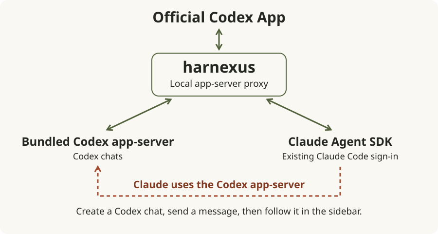

# harnexus

Use Claude in the Codex App. Ask Claude to implement a change and have Codex review it. Claude can use the Codex app-server to create a separate Codex chat, send it the review request, and read its reply. Open that chat from the sidebar to inspect the review and ask Codex a follow-up.

## How it works



harnexus runs on your Mac as a local app-server proxy. It relays ordinary Codex chats to the bundled app-server and runs Claude chats through Anthropic's official Claude Agent SDK using your existing Claude Code sign-in.


## Get started

- Experimental; macOS only.
- ChatGPT app at `/Applications/ChatGPT.app` (override with `HARNEXUS_APP_PATH`).
- Bun installed and Claude Code already signed in.
- Before sending a prompt, harnexus checks that Claude Code is using your subscription login. It rejects API-key or third-party provider authentication.
- Anthropic [currently counts Agent SDK and third-party app usage toward subscription limits](https://support.claude.com/en/articles/15036540-use-the-claude-agent-sdk-with-your-claude-plan).

```sh
git clone https://github.com/riii111/harnexus.git
cd harnexus
bun install
```

Quit the ChatGPT app completely, then open it with harnexus:

```sh
bun run open-app
```

Start a new chat in your project and choose a Claude model.

- Claude chats cannot switch to Codex, but you can use Codex in a side chat.

By default, `open-app` uses the Codex bundled with the ChatGPT app. It configures the macOS launch environment and a LaunchAgent without patching the app or replacing your shell’s `PATH`. To switch back, see [Return to standard Codex](#return-to-standard-codex).

## Features

### Claude in the Codex App

Use Claude in regular app chats.
Claude can coordinate work with Codex through the Codex App Server, creating chats, messaging them directly and archiving them once done.
A chat that archives itself is archived after its reply, unless that turn is stopped or another message is waiting.

### In-app browser

Ask a local Claude chat to check a page in the in-app browser.

### Claude Cloud sessions

Use [Claude Code cloud sessions](https://code.claude.com/docs/en/claude-code-on-the-web) from a new Claude chat:

- `/cloud <request>`: Start a new session.
- `/cloud <session ID or URL>`: Continue an existing session.

Each worker session opens its own chat in the same project.

- New sessions use Auto mode.
- Updates may take a few minutes to appear.
- Cloud chats are text-only.
- Stop Cloud sessions at claude.ai; the app only stops waiting for replies.

## Approvals

- Auto mode by default; requires a supported model and account.
- Claude Code permission rules still apply.
- The app's **Approve for me** setting does not control Claude approvals.

For manual approvals, quit the app and reopen with:

```sh
HARNEXUS_PERMISSION_MODE=default bun run open-app
```

- Launch options persist until you rerun `bun run open-app`; omitted options are cleared.

## Troubleshooting

If Claude is missing or a chat will not start, quit the app completely and run `bun run open-app` again.
Also rerun it after moving the harnexus folder or changing Bun's location.
Run diagnostics:

```sh
bun run doctor
```

Collect diagnostics for a bug report:

```sh
bun run feedback --since 2h
```

Review the output before attaching it to a [bug report](https://github.com/riii111/harnexus/issues/new?template=bug-report.yml).

## Return to standard Codex

Quit the app completely, then run:

```sh
bun run open-app --standard
```

This clears the registered launch settings and removes the harnexus LaunchAgent. Your chats and harnexus data stay in place.
