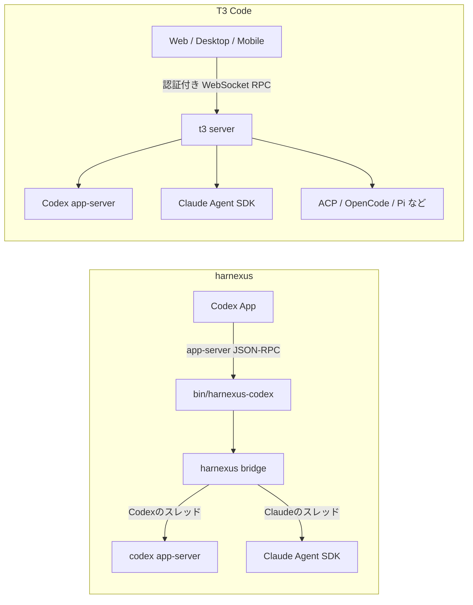

# harnexus と T3 Code の比較

調査日: 2026-11-01

対象:

- harnexus: このリポジトリの `9af4807`（PR #222 の取り込み後）
- T3 Code: [pingdotgg/t3code](https://github.com/pingdotgg/t3code) の `82b10d5`（2026-11-01 時点の main）

T3 Code の根拠リンクは、調査した commit に固定したURLで示す。
「確認済み」はファイルを読んで確かめた内容、「推測」は確かめていない内容を表す。

## 要約

harnexus は、OpenAI の Codex App（ChatGPT アプリ内の Codex）に Claude のチャットを足し、同じ画面で Claude と Codex を協調させる拡張である。
T3 Code は、手元や遠隔のマシンにある複数のコーディングエージェントを1つのUIで操作する独立アプリで、Web・デスクトップ・モバイルの各クライアントを持つ。
harnexus は「Codex App を使い続けたまま Claude を足し、Claude が実装して Codex がレビューする」流れに特化している。
T3 Code は「どのエージェントでも同じ操作感で、どこからでも動かす」ことを目指す汎用の操作画面である。

## 目的と位置づけ

harnexus は README の冒頭で「Use Claude alongside Codex in the Codex App」と述べる（`README.md`）。
Claude と Codex を同じワークスペースの別チャットとして並べ、Claude に実装させて Codex にレビューさせる使い方や、チャット間の手作業のコピーをなくす使い方を想定している（`README.md`）。

T3 Code は自らを「agent harness control surface」と呼ぶ（[README.md][t3-readme]）。
エージェント本体（ハーネス）ではなく、Claude Code や Codex などの既存のハーネスを使う側だと FAQ で明言している（[docs/user/faq.md][t3-faq]）。
Codex のデスクトップアプリ、Conductor、Claude Desktop、Cursor Glass を参考にしたうえで、性能・遠隔操作・完全なオープンソースを差別化点に挙げる（[docs/user/faq.md][t3-faq]）。

## アーキテクチャ

harnexus は独立アプリではなく、Codex App への組み込みである。

- `bun run open-app` が ChatGPT アプリを `CODEX_CLI_PATH` などの環境変数付きで起動し、アプリが呼ぶ Codex CLI を `bin/harnexus-codex` に差し替える（`src/bootstrap/open-app-plan.ts`、`src/bootstrap/open-app.ts`）。
- `bin/harnexus-codex` は `codex app-server` の起動を検出すると bridge を付けて起動する（`bin/harnexus-codex`）。
  bridge は app-server の JSON-RPC の行を中継し、Claude モデルのスレッドだけを自前で処理する（`src/bootstrap/main.ts`、`src/conversation/route.ts`）。
- Claude との接続は `@anthropic-ai/claude-agent-sdk` を使う（`package.json`、`src/infra/claude/sdk.boundary.ts`）。
- Claude から Codex 側のスレッドを操作する道具（`list_projects`・`create_thread`・`send_message_to_thread`・`wait_threads`・`read_thread`）は、SDK 内の MCP サーバー `codex_link` として渡す（`src/infra/codex/codex-link.ts`、`src/infra/codex/call-gateway.ts`）。
- 画面は Codex App のものをそのまま使い、harnexus 独自のUIは持たない（README の記述と `src/presentation/` が app-server の応答形式への変換を担うことからの判断）。

T3 Code は独立したクライアント・サーバー型のアプリである。

- 構成は `apps/server`（npm パッケージ `t3`）、`apps/web`、`apps/desktop`（Electron）、`apps/mobile`（Expo / React Native）で、実行はワークスペースを持つサーバー側に置き、各クライアントは認証付き RPC でそれを操作する（[docs/internals/overview.md][t3-overview]）。
  デスクトップアプリはサーバーを同梱する（同上）。
- 処理はイベントソーシングで、イベントログを正とする（[apps/server/src/orchestration-v2/Orchestrator.ts][t3-orch]）。
  永続化は `node:sqlite` による SQLite である（[apps/server/src/persistence/Sqlite.ts][t3-sqlite]）。
- エージェントとの接続はプロバイダごとのアダプタで抽象化している（[docs/internals/providers.md][t3-providers]）。
  Codex は app-server プロトコル（[packages/effect-codex-app-server][t3-codex-pkg]）、Claude は Claude Agent SDK（[apps/server/src/provider/ClaudeProvider.ts][t3-claude]）、その他は ACP（[docs/user/providers-acp.md][t3-acp]）や OpenCode・Pi の各サーバー／RPC を使う。

両者とも Codex には app-server、Claude には Agent SDK を使う点は同じである。
違いは、harnexus が Codex App と app-server の間に割り込むのに対し、T3 Code は自分のサーバーが app-server を直接起動・操作する点にある。

## 対応エージェント・モデルと認証方式

| 項目 | harnexus | T3 Code |
| --- | --- | --- |
| エージェント | Codex（Codex App 標準）と Claude | Codex、Claude、Cursor、Grok Build、OpenCode、Antigravity、fx、Pi、Muse、ACP Registry のエージェント |
| モデル | Codex App のモデル一覧に Claude モデルを加える（`src/infra/claude/models.ts`、`src/conversation/model-list.ts`） | プロバイダごとのモデル一覧（今回は詳細を確認していない） |
| Claude の認証 | Claude Code でログインした claude.ai のサブスクリプションのみ。APIキーとクラウド事業者のアカウントは非対応（`README.md`）。APIキー系の環境変数を外し、サブスクリプション以外を拒否する（`src/infra/claude/auth.ts`） | Claude Code を入れて `claude auth login` でログインする。別のプロバイダインスタンスとして APIキーや OpenRouter も使える |
| Codex の認証 | Codex App のログインをそのまま使う（README に追加手順がないことからの推測） | T3 Code の設定から ChatGPT のプランで接続する（Codex の導入は T3 Code が行う）か、既存の Codex CLI で `codex login` する |
| 複数アカウント | 記述なし | Codex・Claude で別アカウントの併用手順あり |

T3 Code の根拠は [README.md][t3-readme]、[docs/user/faq.md][t3-faq]、[docs/user/providers-claude.md][t3-pclaude]、[docs/user/providers-codex.md][t3-pcodex] である。
T3 Code は 1Password を秘密情報の提供元として使える（[packages/secret-provider-onepassword][t3-1p]）。

## 主な機能

| 機能 | harnexus | T3 Code |
| --- | --- | --- |
| 複数エージェントの協調 | Claude のチャットから Codex のスレッドを作成・送信・待機できる（`src/infra/codex/codex-link.ts`）。`harnexus-task` の `launch`・`review` で、worker と独立 reviewer を立てて反復させる（`src/task/cli.ts`） | オーケストレータの MCP サーバー経由で、任意のプロバイダの子スレッドへ作業を委任・待機・中断できる（[docs/orchestration-v2/orchestrator-mcp-server.md][t3-mcp]）。外部のエージェントも `/mcp` から操作できる（[docs/user/outside-agents.md][t3-outside]） |
| スレッド途中のエージェント切替 | Claude のチャットは Codex に戻せない（`README.md`） | 会話の文脈を引き継いでプロバイダを切り替えられる。短い会話は全体を、長い会話は選んだメッセージを本文・順序・役割を保ったまま渡し、エージェントが書く要約ではない（[docs/user/portable-handoffs.md][t3-handoff]） |
| レビュー | AI レビュー: Claude の固定SHA差分を Codex reviewer に渡し、判定まで反復する（`src/task/cloud-review.ts`、`src/task/cli.ts`） | 人向けのレビュー画面: Diff ペイン、commit 単位の比較、PR のファイル既読（[docs/user/source-control.md][t3-sc]） |
| PR 連携 | PR のレビュー指摘・CI 失敗などを監視してチャットへ届ける（`src/prwatch/`） | GitHub・GitLab・Forgejo・Bitbucket・Azure DevOps などで clone・公開・PR 作成。エージェントが `watch_pull_request` で PR を監視し、CI の失敗・必須チェックの成功・他者のコメントやレビュー・競合で起こされる（[docs/user/source-control.md][t3-sc]） |
| セッション管理 | 画像添付、サイドチャット、巻き戻し、会話の再開（`README.md`、`src/conversation/side-chat.ts`、`src/conversation/revert-request.ts`） | スレッド一覧、worktree、端末、プランモード、添付（[docs/user/composer.md][t3-composer]、[docs/user/terminal.md][t3-terminal]） |
| Cloud 連携 | Claude Code の Cloud セッションをチャットに表示して送信でき、`/cloud` で新規作成もできる。子セッションも同じプロジェクトのチャットとして開く（`README.md`、`src/infra/claude/cloud.ts`、`src/infra/claude/cloud-new.boundary.ts`） | 該当する機能は見つからなかった（未確認）。代わりに自分のマシンやVPSで動かすサーバーへ遠隔接続する |
| 遠隔・モバイル | なし（macOS の Codex App 上で動く） | T3 Connect（Cloudflare トンネル）、LAN、Tailscale、SSH、iOS・Android アプリ（[docs/user/remote-access.md][t3-remote]） |
| 承認 | 既定は Claude Code の auto モード。`HARNEXUS_PERMISSION_MODE=default` で手動承認（`README.md`、`src/runtime/config.ts`） | Supervised・Auto-accept edits・Auto・Full access。初期の既定は Full access（[docs/user/permission-modes.md][t3-perm]） |
| 診断 | `bun run doctor`、`bun run feedback`（`README.md`） | 利用状況のテレメトリ（無効化可）と使用量表示（[docs/user/faq.md][t3-faq]） |

## 対応プラットフォームと導入手順

harnexus は macOS のみで、`/Applications/ChatGPT.app`、Bun 1.4.4、ログイン済みの Claude Code が必要である（`README.md`）。
導入はリポジトリを clone して `bun install` し、ChatGPT アプリを終了してから `bun run open-app` で起動する（`README.md`）。
checkout と Bun の場所を変えず、更新後は `bun run open-app` をやり直す必要がある（`README.md`）。
`bun run open-app --standard` で通常の Codex に戻せる（`README.md`）。

T3 Code は Windows・macOS・Linux に対応する（Intel Mac は CLI がなくデスクトップアプリのみ）（[docs/user/faq.md][t3-faq]）。
導入は `curl -fsSL https://t3.codes/install.sh | sh` の後に `t3` を実行するか、`npx t3@latest` で試す（[README.md][t3-readme]）。
デスクトップアプリは GitHub Releases、winget、scoop、Homebrew、`.deb`、AUR、nixpkgs で配布する（[README.md][t3-readme]）。
サーバーの Node 要件は `^22.16 || ^23.11 || >=24.10` で（[apps/server/package.json][t3-server-pkg]）。
プロバイダの導入と認証は、サーバーを動かすマシンでプロバイダごとに行う（[docs/user/install.md][t3-install]）。
多くは各CLIを入れてログインするが、ChatGPT で接続した Codex と Antigravity は T3 Code が管理するランタイムを使え、CLIを別に入れる必要はない（同上、[docs/user/providers-codex.md][t3-pcodex]）。

## 成熟度・ライセンス・開発状況

| 項目 | harnexus | T3 Code |
| --- | --- | --- |
| 版 | `0.0.0`、`private: true`（`package.json`） | server・web・desktop が `0.1.6`（[apps/server/package.json][t3-server-pkg]）。タグは `v0.1.6` と `v0.1.7-nightly.20261101.4016` |
| 状態の表明 | 「Experimental」（`README.md`） | 「We are very very early in this project. Expect bugs.」（[README.md][t3-readme]） |
| ライセンス | リポジトリにライセンスファイルがなく、README にも記載がない | MIT（[LICENSE][t3-license]） |
| 外部からの貢献 | 方針の記載なし。Issue テンプレートはある（`.github/ISSUE_TEMPLATE/`） | ほぼ受け付けない。小さな修正のみ検討（[README.md][t3-readme]、[CONTRIBUTING.md][t3-contrib]） |
| 開発の速さ | commit 件名の PR 番号は #222 まで | 直近 200 commit が 2026-10-31 から 2026-11-01 の約1日に収まり、PR 番号は #28665 に達する |
| 利用規約 | Claude の利用は Anthropic の規約の範囲で Claude プランに計上される（`README.md`） | Claude Code・Codex・Antigravity の規約の範囲内だと FAQ で表明（[docs/user/faq.md][t3-faq]） |

確かめられなかった点: harnexus の調査用 checkout は浅い clone で、開発開始日や総 commit 数は確認していない。
T3 Code の利用者数、リリースの頻度、モデル一覧の詳細も確認していない。

## harnexus から見た使い分けの指針

次の場合は harnexus が向く。

- Codex App を主な作業場所にしたまま、Claude を同じ画面で使いたい。
- Claude に実装させ、Codex に固定SHAの差分をレビューさせる流れを、`harnexus-task` で定型化して回したい。
- Claude Code の Cloud セッションを Codex App から追い、子セッションも同じ画面で見たい。

次の場合は T3 Code が向く。

- Codex・Claude 以外のエージェント（Cursor、OpenCode、ACP 対応のものなど）も1つの画面で扱いたい。
- Windows・Linux で使いたい、あるいはスマートフォンや別のマシンから自宅やVPSのエージェントを操作したい。
- APIキーや OpenRouter など、サブスクリプション以外の認証で Claude を使いたい。
- ライセンスが明確なオープンソースを前提にしたい。

両者は排他ではない。
T3 Code の外部エージェント用 MCP（[docs/user/outside-agents.md][t3-outside]）は Claude Code や Codex から接続できるため、harnexus の Claude チャットから T3 Code の環境を操作する組み合わせも原理上は可能である（推測。試していない）。

以下は推測である。
T3 Code はエージェントの種類と利用場所の広さで harnexus を大きく上回り、開発の速さも桁違いである。
harnexus が独自の価値を保てるのは、Codex App の画面と会話の仕組みをそのまま使う点、Claude と Codex の役割分担（実装と独立レビュー）を道具として組み込んでいる点、Claude Code の Cloud 連携の3点である。
T3 Code にもスレッド間の委任はあるが、固定SHAでのレビュー反復や判定の記録にあたる機能は今回の調査では見つからなかった。

[t3-readme]: https://github.com/pingdotgg/t3code/blob/82b10d546c1041d8eff40425f076d61f608d518f/README.md
[t3-faq]: https://github.com/pingdotgg/t3code/blob/82b10d546c1041d8eff40425f076d61f608d518f/docs/user/faq.md
[t3-overview]: https://github.com/pingdotgg/t3code/blob/82b10d546c1041d8eff40425f076d61f608d518f/docs/internals/overview.md
[t3-orch]: https://github.com/pingdotgg/t3code/blob/82b10d546c1041d8eff40425f076d61f608d518f/apps/server/src/orchestration-v2/Orchestrator.ts
[t3-sqlite]: https://github.com/pingdotgg/t3code/blob/82b10d546c1041d8eff40425f076d61f608d518f/apps/server/src/persistence/Sqlite.ts
[t3-providers]: https://github.com/pingdotgg/t3code/blob/82b10d546c1041d8eff40425f076d61f608d518f/docs/internals/providers.md
[t3-codex-pkg]: https://github.com/pingdotgg/t3code/tree/82b10d546c1041d8eff40425f076d61f608d518f/packages/effect-codex-app-server
[t3-claude]: https://github.com/pingdotgg/t3code/blob/82b10d546c1041d8eff40425f076d61f608d518f/apps/server/src/provider/ClaudeProvider.ts
[t3-acp]: https://github.com/pingdotgg/t3code/blob/82b10d546c1041d8eff40425f076d61f608d518f/docs/user/providers-acp.md
[t3-pclaude]: https://github.com/pingdotgg/t3code/blob/82b10d546c1041d8eff40425f076d61f608d518f/docs/user/providers-claude.md
[t3-pcodex]: https://github.com/pingdotgg/t3code/blob/82b10d546c1041d8eff40425f076d61f608d518f/docs/user/providers-codex.md
[t3-1p]: https://github.com/pingdotgg/t3code/tree/82b10d546c1041d8eff40425f076d61f608d518f/packages/secret-provider-onepassword
[t3-mcp]: https://github.com/pingdotgg/t3code/blob/82b10d546c1041d8eff40425f076d61f608d518f/docs/orchestration-v2/orchestrator-mcp-server.md
[t3-outside]: https://github.com/pingdotgg/t3code/blob/82b10d546c1041d8eff40425f076d61f608d518f/docs/user/outside-agents.md
[t3-handoff]: https://github.com/pingdotgg/t3code/blob/82b10d546c1041d8eff40425f076d61f608d518f/docs/user/portable-handoffs.md
[t3-sc]: https://github.com/pingdotgg/t3code/blob/82b10d546c1041d8eff40425f076d61f608d518f/docs/user/source-control.md
[t3-composer]: https://github.com/pingdotgg/t3code/blob/82b10d546c1041d8eff40425f076d61f608d518f/docs/user/composer.md
[t3-terminal]: https://github.com/pingdotgg/t3code/blob/82b10d546c1041d8eff40425f076d61f608d518f/docs/user/terminal.md
[t3-remote]: https://github.com/pingdotgg/t3code/blob/82b10d546c1041d8eff40425f076d61f608d518f/docs/user/remote-access.md
[t3-perm]: https://github.com/pingdotgg/t3code/blob/82b10d546c1041d8eff40425f076d61f608d518f/docs/user/permission-modes.md
[t3-install]: https://github.com/pingdotgg/t3code/blob/82b10d546c1041d8eff40425f076d61f608d518f/docs/user/install.md
[t3-server-pkg]: https://github.com/pingdotgg/t3code/blob/82b10d546c1041d8eff40425f076d61f608d518f/apps/server/package.json
[t3-license]: https://github.com/pingdotgg/t3code/blob/82b10d546c1041d8eff40425f076d61f608d518f/LICENSE
[t3-contrib]: https://github.com/pingdotgg/t3code/blob/82b10d546c1041d8eff40425f076d61f608d518f/CONTRIBUTING.md
